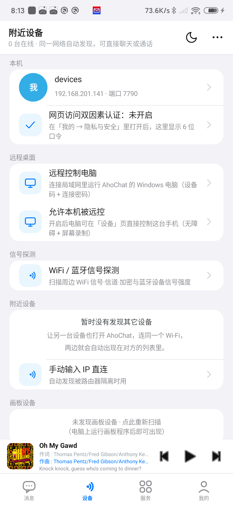
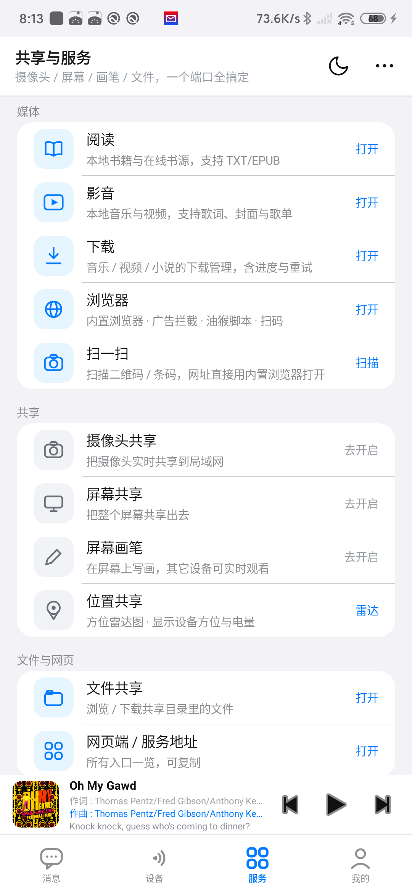
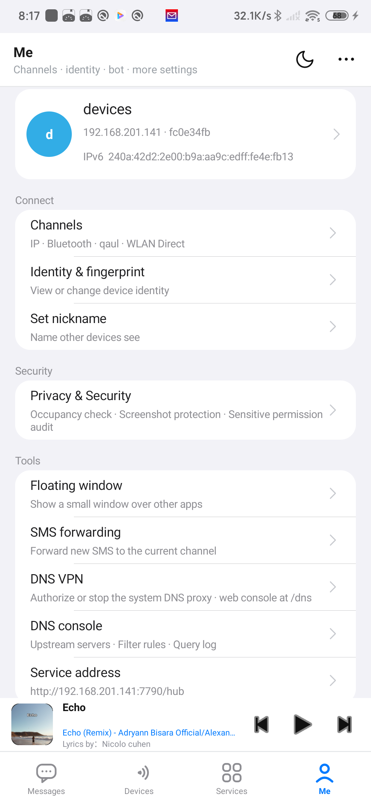

# AhoChatA

(https://github.com/yuwenhui2020/AhoChatA)

**Ad-hoc Chat for Android** · 免服务器、免账号的局域网优先即时通信
*Serverless, account-free, LAN-first messenger for Android*

[简体中文](#简体中文) · [English](#english) · [MIT License](#license)

| 中文界面 | English UI |
| :---: | :---: |
|  |  |
|  |  |
|  |  |
|  |  |

---

## 简体中文

### 这是什么

**AhoChatA**（*ad-hoc chat, Android*）是一款安卓端的**自组网聊天工具**：同一个 Wi-Fi 下的两台手机、或手机与电脑，打开就能互相发现、直接聊天、通话、传文件——**没有服务器、没有注册登录，消息不经过任何云端**。

**本程序无官方服务器，是真正的自组网：每一台设备地位完全对等，既是客户端也是路由器，共同组成对等网络（P2P mesh）。** 没有中心节点可以关停，也没有任何后台收集数据的服务。

没有路由器、没有网络时，它还能通过 **qaul（libp2p）**、**蓝牙自组网**、**WLAN Direct（Wi-Fi 直连）** 把设备连起来；跨网段/跨公网时，一台设备即可充当**中继**——连接中继只是**多一个联网通信功能**，本地局域网能力与设备发现保持不变。

> **主要用途**：在网络中断地区使用 **WLAN Direct** 构建对等网络，恢复基础通信功能。
>
> **合规约束**：禁止任何用户将本程序用于煽动任何国家的政治体系。项目仅提供通信技术，不承担使用方式带来的责任。

> 本仓库是 AhoChat 系列的 **Android 客户端**；应用包名 `com.Ahochat.android`，应用名 `AhoChat`。

### 主要功能

| 分类 | 能力 |
| --- | --- |
| 聊天 | 局域网自动发现、私聊 / 频道 / 群组、文本 / 图片 / 语音 / 视频 / 文件、撤回与编辑、消息去重（id → 内容 → 跨渠道三层） |
| 自组网 | 局域网 TCP、qaul / libp2p、蓝牙网状（Bitchat）、WLAN Direct、静态中继；断线重连、跳数限制、出站队列 |
| 通话 | 语音通话、视频通话（H.264，失败自动降级为整帧 JPEG） |
| 一起看 / 一起听 | 同步播放进度，可自由切歌、切集，自动对齐时钟 |
| 文件与下载 | HTTP 文件共享、FTP、断点续传；内置下载器支持 m3u8、AES-128、多线程分片、限速与后台下载 |
| 共享 | 屏幕共享 / 投屏、IP 摄像头（手机变局域网视频源）、屏幕画笔直播、位置共享与方位雷达 |
| 远程桌面 | 手机远控电脑；也允许电脑远控手机（无障碍 + 屏幕录制 + H.264 编解码） |
| 浏览器 | ABP 语法广告拦截、油猴脚本（GM_* API）、阅读模式、网页翻译、长截图、网页转 PDF、无痕窗口、多标签 |
| 阅读 | TXT / EPUB / PDF / FB2 / Markdown，兼容 legado 书源，支持网页端上传与整本缓存 |
| 影音 | 本地音乐 / 视频播放、歌词与封面、歌单、在线影视源（TVBox 订阅）、投屏 |
| 系统增强 | DNS VPN 广告过滤（DoH / DoT）、短信转发、通知转发、悬浮窗、开机自启、后台常驻 |
| 界面 | 中文 / English 双语，跟随系统语言自动切换，也可在「我的 → 语言」手动锁定；浅色 / 深色主题 |

### 网络与频道约束

| 规则 | 说明 |
| --- | --- |
| 蓝牙渠道原理 | 蓝牙链路采用 **bitchat** 的 BLE GATT mesh 原理：每个设备同时充当外设（GATT Server 广播）与中心（扫描连接），文本消息按信封逐跳中继。安装包外发走系统蓝牙分享或局域网 HTTP，不经 bitchat 文件协议。 |
| 局域网定义 | 只有**双向互通**的设备才算同一局域网（hello ↔ probe ↔ hello 握手确认）。同一设备**不同网卡**下的设备同属一个局域网；**WLAN Direct** 视为另一张网卡，连接的设备同样属于局域网。 |
| mesh 频道 | 默认 `chan:mesh` 的消息**绝不经中继流转**：只在完成双向确认的局域网设备间传输，不经过 qaul 公共节点、静态中继站或蓝牙逐跳，防止有人借中继节点广播不良信息。 |
| 中继模式 | 连接中继只是**多一条联网通信渠道**，不改变本地行为：局域网组播 / 蓝牙广播扫描 / WLAN Direct 发现 / mDNS 照常开启，本地设备仍可发现、仍能在局域网私聊与频道聊天。**中继那边的远端设备不纳入本地发现列表**，中继仅作为跨网段 / 公网的通信渠道使用。 |
| 频道临时性 | 加入的所有频道**退出程序即不保存**；下次启动只重建内置 `mesh` 默认频道。 |

**局域网范围**：要求双向互通才算局域网；同一设备不同网卡下的所有设备可以组成同一个局域网；使用 WLAN Direct 连接的设备视为不同网卡，同样可以作为局域网。

### 分享本程序

「我的 → 关于 → 分享本程序」提供三种渠道：

1. **安装链接**：gh-proxy 加速的 GitHub release 地址，可直接文本分享；
2. **蓝牙 / 外部应用**：把本机安装包交给系统分享面板，可选择蓝牙发送到其它设备；
3. **局域网文件共享**：把安装包放进网页 `/file` 共享根目录，同一局域网设备直接用浏览器下载。

### 技术栈

| 项 | 说明 |
| --- | --- |
| 平台 | Android，`minSdk 21` / `targetSdk 33` |
| 框架 | Xamarin.Android（`.csproj` 老式工程，`MonoAndroid v13.0`） |
| 界面 | 原生 View 体系 + 自绘图标（`DesignSystem.cs` / `Icons.cs`），无 Xamarin.Forms |
| 网页端 | 内嵌 `WebServer`（HTTP + WebSocket）+ `Assets/www`、`Assets/webui` |
| 打包 | MSBuild → zipalign → apksigner（`build.bat` 一键完成） |

端口约定：`45777/UDP` 发现（组播 224.0.0.167）、`45778/TCP` 自有帧、`7790` 网页网关、`6800` 内嵌 SPA、`9200` qaul 节点。

### 构建

环境要求：

| 组件 | 版本 / 默认路径 |
| --- | --- |
| Visual Studio 2022 | MSBuild（`C:\Program Files\Microsoft Visual Studio\2022\Community\MSBuild\Current\Bin`） |
| Android SDK | API 33（`C:\Program Files (x86)\Android\android-sdk`），build-tools 35.0.0 |
| JDK | 17（`C:\Program Files\Java\jdk-17.0.1`） |

```bat
build.bat            :: 编译 + 签名 + 安装到已连接手机
build.bat -n         :: 只编译 + 签名（产物 dist\com.Ahochat.android.apk）
build.bat clean      :: 全量重编
build.bat --help     :: 查看全部参数
```

首次构建自动还原 NuGet 包；也可以直接用 Visual Studio 打开 `AhoChatA.sln`。
在 MIUI 上 `adb install` 可能报 `INSTALL_FAILED_USER_RESTRICTED`，把 APK 推到手机后用系统安装器安装，或对已安装的同签名包用 `adb install -r` 覆盖。

### 多语言实现

界面文案以中文为源，运行时经 `L10n.T("中文")` 查表替换（表在 `L10n.Dict.cs`）：中文环境原样返回，英文环境查表翻译、查不到回退中文，因此不会出现空白或异常。生效点有三处：界面建好后遍历视图树、`L10n.Toast` / `L10n.Dialog` 统一入口、以及动态文案的内联 `L10n.T`。各界面标题、无障碍说明等另提供 `values`（英文）与 `values-zh`（中文）资源。

内嵌网页端（浏览器打开 `http://手机IP:6789` 访问的聊天 / 设置 / 阅读器 / 影音 / 文件分享）走独立的一层：`Assets/webui/js/i18n.js` 内含 883 条中英对照，跟随浏览器语言自动切换，也可用 `?lang=zh` / `?lang=en` 或 `localStorage['ahochat.lang']` 覆盖；翻译通过 DOM 监听完成，新渲染的文案同样生效。聊天正文、书籍正文、文件名、设备名等用户数据一律不翻译。旧版 SPA 目录 `Assets/www` 有同样的一套（532 条）。

### 目录速览

```
AhoChatA.sln / .csproj   解决方案与工程（包名 com.Ahochat.android）
ChatActivity.cs          主界面：消息 / 设备 / 服务 / 我的
BaseActivity.cs          统一基类：主题、系统栏、语言刷新
L10n.cs / L10n.Dict.cs   运行时多语言层与中英对照表
MchatBridge.cs           多链路收发、去重、加密、中转
Libp2p/ Qaul/ Bitchat/   qaul、蓝牙、WLAN Direct 传输
Chat/ Music/ Reader/ Vod/ 聊天辅助、音乐、阅读、影视模块
Assets/www/              内嵌网页端（聊天、设置、阅读器、播放器）
Resources/layout/        原生布局（顶栏、底栏、通话、摄像头等）
build.bat                构建 / 签名 / 安装脚本
docs/screenshots/        README 截图
```

### 更新日志

**1.0.1**
- 网页聊天界面与 App 统一：iOS 蓝气泡、圆形头像、5 分钟时间分隔。
- 音乐 / 视频下载完成自动刷新，列表标注本地资源，新增分享到聊天频道 / 外部应用。
- 修复内置浏览器 JS 跳转新标签后台打开与标签计数不更新；底栏图标适配夜间主题。
- 新增自动更新管理器（gh-proxy 加速、版本比较、更新说明弹窗、mesh 频道更新卡片）与「关于」页。
- 新增分享本程序：安装链接 / 蓝牙 / 局域网文件共享三种渠道。
- mesh 频道收紧为局域网双向互通且绝不经中继；连接中继仅新增联网通信渠道，本地发现与局域网聊天不受影响，中继远端设备不纳入发现；频道退出即清空。
- 修复通知栏 FileProvider 崩溃、网页翻译回调线程、m3u8 误判与下载重试上下文丢失。

### 许可

MIT License，详见 [LICENSE](LICENSE)。

---

## English

### What is this

**AhoChatA** (*ad-hoc chat, Android*) is a **self-organising messenger for Android**. Two phones — or a phone and a PC — on the same Wi-Fi find each other and start chatting, calling and swapping files right away. **No server, no sign-up, and no cloud in the middle.**

**There is no official server — this is a true ad-hoc network: every device is fully equal, acting as both client and router, forming a peer-to-peer mesh.**

Without a router or any network it still links devices through **qaul (libp2p)**, **Bluetooth mesh** and **WLAN Direct**; across subnets or over the internet, any device can act as a **relay** — connecting to one simply adds an online communication channel and never disables local LAN discovery or chatting.

> **Purpose**: rebuild peer-to-peer networks with **WLAN Direct** in areas without connectivity, restoring basic communications.
>
> **Compliance**: never use this app to incite the political system of any country.

> This repository is the **Android client** of the AhoChat family. Package `com.Ahochat.android`, app name `AhoChat`.

### Features

| Area | Highlights |
| --- | --- |
| Chat | Automatic LAN discovery; private chats, channels and groups; text, photos, voice, video and files; recall and edit; three-layer de-duplication (id → content → cross-channel) |
| Mesh | LAN TCP, qaul / libp2p, Bluetooth mesh (Bitchat), WLAN Direct, static relays; auto-reconnect, hop limits, outbound queue |
| Calls | Voice and video (H.264 with automatic fallback to full-frame JPEG) |
| Watch / listen together | Synchronised playback, free to switch songs or episodes, automatic clock alignment |
| Files & downloads | HTTP file sharing, FTP, resumable transfers; built-in downloader with m3u8, AES-128, multi-threaded chunks, speed limits and background downloads |
| Sharing | Screen sharing / casting, IP camera (phone as a LAN video source), live drawing board, location sharing with a compass radar |
| Remote desktop | Control a PC from the phone, or let a PC control the phone (accessibility + screen recording + H.264 codec) |
| Browser | ABP ad blocking, user scripts (GM_* APIs), reader mode, page translation, long screenshots, page-to-PDF, incognito, tabs |
| Reader | TXT / EPUB / PDF / FB2 / Markdown with legado-compatible book sources, web upload and whole-book caching |
| Media | Local music / video playback, lyrics and covers, playlists, online video sources (TVBox feeds), casting |
| System extras | DNS VPN ad filtering (DoH / DoT), SMS forwarding, notification relay, floating window, boot autostart, background service |
| UI | Chinese / English, switched automatically by system language or manually under **Me → Language**; light and dark themes |

### Network & channel rules

| Rule | Details |
| --- | --- |
| Bluetooth principle | The Bluetooth link uses **bitchat**'s BLE GATT mesh: every device is both a GATT server (advertising) and a central (scanning/connecting), relaying text messages hop by hop. Installer files are shared via the system Bluetooth share sheet or LAN HTTP, not a bitchat file protocol. |
| LAN definition | Only **bidirectionally reachable** devices count as LAN (hello ↔ probe ↔ hello handshake). Devices behind **different network interfaces of the same machine** form one LAN; **WLAN Direct** peers count as another interface and belong to the LAN too. |
| mesh channel | Messages in the default `chan:mesh` **never traverse a relay**: they stay inside the LAN between bidirectionally confirmed devices, never via qaul public nodes, static relays or Bluetooth hops. |
| Relay mode | Connecting to a relay only **adds an online communication channel**: LAN multicast, BLE advertising/scanning, WLAN Direct discovery and mDNS stay on; local devices are still discoverable and LAN chats (including DMs) keep working. Remote devices behind the relay are **excluded from local discovery** — the relay is used purely as a transport. |
| Ephemeral channels | Joined channels are **not saved on exit**; only the built-in `mesh` default channel is recreated at next launch. |

**LAN scope**: bidirectional reachability is required; devices under different NICs of the same host form one LAN; WLAN Direct devices are treated as a separate NIC and are equally part of the LAN.

### Sharing this app

**Me → About → Share** offers three channels: (1) gh-proxy accelerated install link, (2) local installer via the system share sheet (Bluetooth target included), (3) copy the installer into the web `/file` LAN share root.

### Stack

| Item | Notes |
| --- | --- |
| Platform | Android, `minSdk 21` / `targetSdk 33` |
| Framework | Xamarin.Android (classic `.csproj`, `MonoAndroid v13.0`) |
| UI | Native views with hand-drawn icons (`DesignSystem.cs` / `Icons.cs`), no Xamarin.Forms |
| Web | Embedded `WebServer` (HTTP + WebSocket) serving `Assets/www` and `Assets/webui` |
| Packaging | MSBuild → zipalign → apksigner, all driven by `build.bat` |

Ports: `45777/UDP` discovery (multicast 224.0.0.167), `45778/TCP` native frames, `7790` web gateway, `6800` embedded SPA, `9200` qaul node.

### Build

Requirements:

| Component | Version / default path |
| --- | --- |
| Visual Studio 2022 | MSBuild (`C:\Program Files\Microsoft Visual Studio\2022\Community\MSBuild\Current\Bin`) |
| Android SDK | API 33 (`C:\Program Files (x86)\Android\android-sdk`), build-tools 35.0.0 |
| JDK | 17 (`C:\Program Files\Java\jdk-17.0.1`) |

```bat
build.bat            :: build + sign + install to a connected phone
build.bat -n         :: build + sign only (output: dist\com.Ahochat.android.apk)
build.bat clean      :: full rebuild
build.bat --help     :: all options
```

NuGet packages are restored automatically on the first build. You can also open `AhoChatA.sln` in Visual Studio.
On MIUI, `adb install` may fail with `INSTALL_FAILED_USER_RESTRICTED`; push the APK and use the system installer, or use `adb install -r` to update an already installed build with the same signature.

### Localisation

UI strings are authored in Chinese and translated at runtime by `L10n.T("中文")` through the table in `L10n.Dict.cs`: Chinese mode returns the original text, English mode looks it up and falls back to Chinese when a string is missing — no blanks, no crashes. It applies in three places: a view-tree pass after each screen is built, the shared `L10n.Toast` / `L10n.Dialog` entry points, and inline `L10n.T` calls for dynamically refreshed text. Screen titles and the accessibility description are provided as `values` (English) and `values-zh` (Chinese) resources.

The built-in web UI (open `http://<phone-ip>:6789` for chat / settings / reader / media / file sharing) has its own layer: `Assets/webui/js/i18n.js` ships 883 zh → en entries, follows the browser language, and can be overridden with `?lang=zh` / `?lang=en` or `localStorage['ahochat.lang']`. Translation runs through a DOM observer, so freshly rendered text is covered too. User data — message bodies, book text, file names, device names — is never translated. The legacy SPA under `Assets/www` has the same setup with 532 entries.

### Layout

```
AhoChatA.sln / .csproj   solution and project (package com.Ahochat.android)
ChatActivity.cs          main screen: Messages / Devices / Services / Me
BaseActivity.cs          shared base: theme, system bars, language refresh
L10n.cs / L10n.Dict.cs   runtime localisation and the zh → en table
MchatBridge.cs           multi-link transport, de-duplication, crypto, relay
Libp2p/ Qaul/ Bitchat/   qaul, Bluetooth and WLAN Direct transports
Chat/ Music/ Reader/ Vod/ chat helpers, music, reader, video modules
Assets/www/              built-in web UI (chat, settings, reader, player)
Resources/layout/        native layouts (top bar, tab bar, call, camera)
build.bat                build / sign / install script
docs/screenshots/        screenshots used by this README
```

### Changelog

**1.0.1**
- Web chat UI aligned with the native app: iOS blue bubbles, round avatars, 5-minute time separators.
- Downloaded media auto-refreshes, is marked local, and can be shared to a channel or external app.
- Fixed browser JS pop-ups opening in the background with a stale tab count; dark-mode toolbar icons.
- Added auto-update manager (gh-proxy, segmented version compare, release notes, mesh update card) and an About screen.
- Added app sharing: install link / Bluetooth / LAN file share.
- mesh is now LAN-only with bidirectional confirmation and never relayed; connecting a relay only adds an online channel without disabling local discovery or chat, and relay-side devices are kept out of discovery; channels are cleared on exit.
- Fixed FileProvider notification crash, translation callback thread, m3u8 misdetection and retry context loss.

### License

MIT — see [LICENSE](LICENSE).
