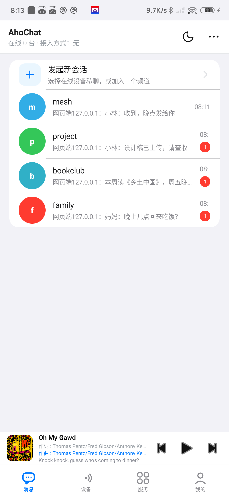
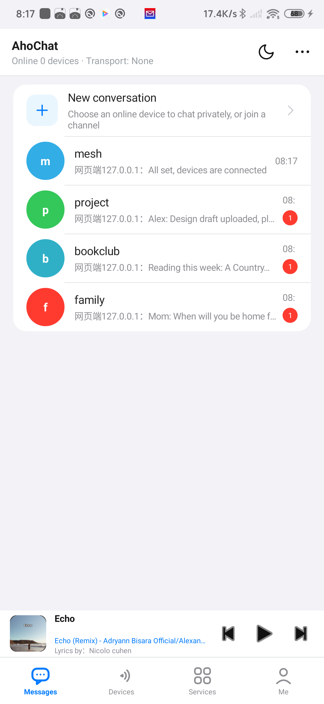
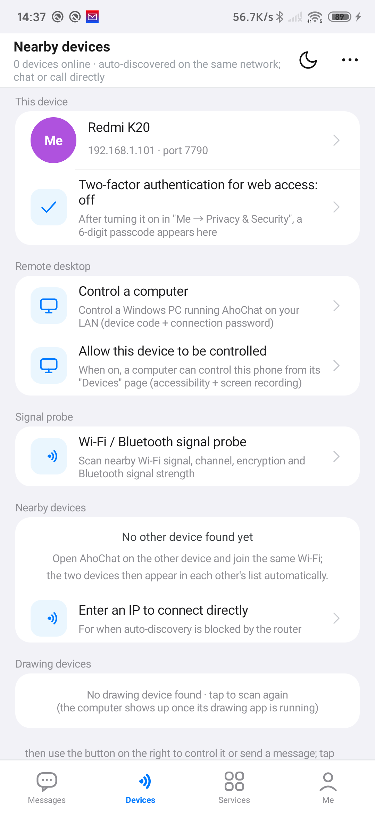
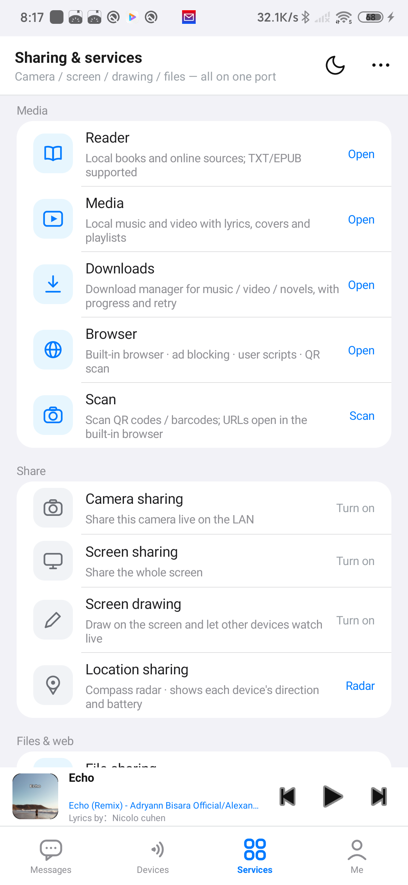
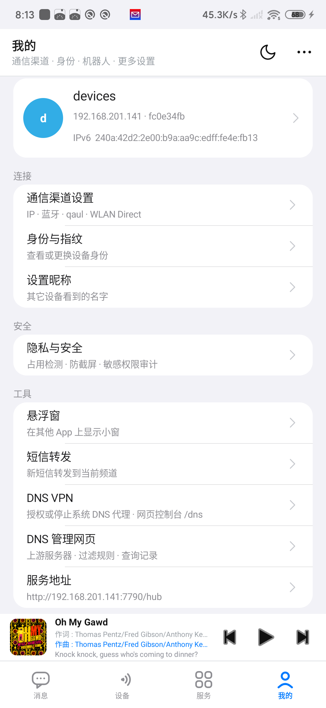

# AhoChat

**Ad-hoc Chat for Android** · 免服务器、免账号的局域网优先即时通信
*Serverless, account-free, LAN-first messenger for Android*

[简体中文](#简体中文) · [English](#english) · [MIT License](#license)

| 中文界面 | English UI |
| :---: | :---: |
|  |  |
|  |  |
|  |  |
|  |  |

---

## 简体中文

### 这是什么

**AhoChat**（*ad-hoc chat, Android*）是一款安卓端的**自组网聊天工具**：同一个 Wi-Fi 下的两台手机、或手机与电脑，打开就能互相发现、直接聊天、通话、传文件——**没有服务器、没有注册登录，消息不经过任何云端**。

没有路由器、没有网络时，它还能通过 **qaul（libp2p）**、**蓝牙自组网**、**WLAN Direct（Wi-Fi 直连）** 把设备连起来；跨网段/跨公网时，一台设备即可充当**中继**。

> 本仓库是 AhoChat 系列的 **Android 客户端**；应用包名 `com.Ahochat.android`，应用名 `AhoChat`。

### 主要功能

| 分类 | 能力 |
| --- | --- |
| 聊天 | 局域网自动发现、私聊 / 频道 / 群组、文本 / 图片 / 语音 / 视频 / 文件、撤回与编辑、消息去重（id → 内容 → 跨渠道三层） |
| 自组网 | 局域网 TCP、qaul / libp2p、蓝牙网状（Bitchat）、WLAN Direct、静态中继；断线重连、跳数限制、出站队列 |
| 通话 | 语音通话、视频通话（H.264，失败自动降级为整帧 JPEG） |
| 一起看 / 一起听 | 同步听（NTP 四时间戳对时 + ±6% 变速追赶）、一起听（整条队列随卡片下发）、一起看（视频进度镜像） |
| 文件与下载 | HTTP 文件共享、FTP、断点续传；内置下载器支持 m3u8、AES-128、多线程分片、限速与后台下载 |
| 共享 | 屏幕共享 / 投屏、IP 摄像头（手机变局域网视频源）、屏幕画笔直播、位置共享与方位雷达 |
| 远程桌面 | 手机远控电脑；也允许电脑远控手机（无障碍 + 屏幕录制 + H.264 编解码） |
| 浏览器 | ABP 语法广告拦截、油猴脚本（18 个 GM_* API）、阅读模式、网页翻译、长截图、网页转 PDF、无痕窗口、多标签 |
| 阅读与办公 | Word / Excel / PPT / PDF 直接打开（PPT 可全屏放映）、TXT / EPUB / FB2 / Markdown、3D 模型、legado 书源、网页端上传与整本缓存 |
| 影音 | 逐行与双语歌词、封面、歌单、在线影视源（TVBox 订阅）、投屏 |
| 系统增强 | DNS VPN 广告过滤（DoH / DoT）、短信转发、通知转发、悬浮窗（可后台收发）、开机自启、**退出即清**（消息不落盘） |
| 网页端 | 浏览器直接聊天 / 读文档 / 听歌 / 看视频 / 传文件 / 看位置，可选 6 位动态口令 2FA |
| 界面 | 中文 / English 双语，跟随系统语言自动切换，也可在「我的 → 语言」手动锁定；浅色 / 深色主题 |

### 功能详解

下面几节展开「主要功能」表里最容易一句话带过、但实际最能区别于其他自组网软件的部分。

#### 阅读与手机简易办公：Word / Excel / PPT / PDF 直接打开

聊天收到的附件、文件管理器里点开的文档，都能在应用内直接看——不装 WPS、不传电脑、不联网转换。

| 格式 | 解析引擎 | 能力 |
| --- | --- | --- |
| `.docx` `.docm` `.dotx` | docx-preview | 段落、表格、图片、页眉页脚、超链接；两套渲染：分页视图按 A4 纸宽排版（`docx-pages.js`），连续视图适合手机竖屏长文（`docx-lines.js`），另有夜间配色（`docx-night.js`） |
| `.doc` | 自研 prose 阅读器 | 老二进制 Word 格式，抽取正文与基础样式，不追求版式还原 |
| `.xlsx` `.xlsm` `.xls` `.csv` | SheetJS | 多工作表切换、列宽、公式结果值 |
| `.pptx` `.pptm` `.ppsx` `.ppt` | PPTXjs + 自研放映台 | 单页浏览，以及**全屏放映**（以窗口等比铺满、左右翻页） |
| `.pdf` | pdf.js（含 wasm 与 CMap） | 连续滚动、双指缩放、文本层可选中，中文 PDF 不缺字 |
| `.txt` `.md` `.epub` `.fb2` | 原生 / marked / epub.js | 编码自动识别（GBK / UTF-8）、目录跳转、字号与背景调节、夜间模式 |
| `.stl` 等 3D 模型 | 自研 WebGL 查看器 | 拖拽旋转、缩放查看 |

实现上没有任何“在线转换”环节：文档字节从私有目录经虚拟域名 `https://mchat.doc/` 喂给 WebView，`ShouldInterceptRequest` 同时重写新旧两个重载（只重写 `string` 版本的老 WebView 会白屏），前端 JS 库在本地解析，生成的 HTML 再经 DOMPurify 净化。因此**断网可用、文件不出设备**。

另外注册了系统「打开方式」：在文件管理器或别的聊天软件里点 docx / pptx / pdf，可以直接选 AhoChat 打开。

> **边界**：这是**阅读器**，不是编辑器。能看、能全屏放映 PPT、能从 PDF 里选字，但不提供改字、改表格、另存。真要在手机上改稿仍需 Office / WPS。

#### 音乐与视频同步播放

三种模式，用途不同：

| 模式 | 行为 | 适合 |
| --- | --- | --- |
| 一起听 | 共享**整条播放队列**，对端加载后各播各的，可自由切歌、拖进度 | 各戴耳机听同一张歌单 |
| 同步听 | 同一时刻只放同一首，**发起端是唯一权威时钟** | 两台手机当一对音箱 |
| 一起看 | 视频进度镜像，宿主机播到哪，跟随端就到哪 | 一起追剧、看同一路直播源 |

同步不是“发个进度让对方 seek”——那样每次都慢半拍。实际做法分四层：

1. **对时**：Cristian 四时间戳（T1 发出 / T2 服务端收到 / T3 服务端回 / T4 收到），`offset = ((T2−T1)+(T3−T4))/2`，`delay = (T4−T1)−(T3−T2)`；样本按 RTT 排序取**最小 RTT** 那组（排队只会让 RTT 变大），保留最近 8 组防时钟漂移。两条采样通道：mesh 瞬时帧 `syncping/syncpong`（测出的 RTT 最贴近卡片真实时延）、HTTP `/api/sync/time`（链路不通时给网页端用）。
2. **锚点**：每张卡片是一个 `(position, ts, playing)`，目标进度 = `position + (发起端此刻 − ts) + 本机自收到帧起走过的毫秒`，自动补偿“生成→投递→收到”的单程时延与两机时钟差。
3. **闭环**：每 250ms 比一次，偏差 <120ms 不动，120–1500ms 用 **±6% 变速**渐进追上（听不出跳变），>1500ms 才硬 seek（带冷却），避免每秒一拖造成卡顿。
4. **定位**：曲目按 `songKey` 而非列表下标匹配，杜绝“切了动作却放了别的歌”。

**歌词**：解析 LRC（`[mm:ss.xx]` / `[mm:ss.xxx]`、一行多时间标签、`[offset:]` 全局偏移、`[ti:]/[ar:]/[al:]` 元信息），**随播放进度逐行流转**：当前行高亮放大、列表平滑滚动居中；**双语歌词同时间戳整组高亮**，不会出现“上一行亮了、译文还留在下面”的错位。歌词来源三路：音频内嵌标签、同名 `.lrc` 文件、在线源返回字段。同步听时歌词跟着权威时钟走，双方看到的是同一句。

**与 AudioRelay / SoundSeeder 的区别**

- **AudioRelay** 解决“声音从 A 设备到 B 设备”：本质是音频路由/串流工具，通常要在电脑装服务端，把 PC 声音低延迟推到手机（或反向），让你**听到**。AhoChat 不抢这个场景——它不做超低延迟音频串流，不能当无线监听耳机用。
- **SoundSeeder** 解决“多台设备同步播同一首歌”，把几台旧手机变成分布式音箱，主打派对，音源以本地文件为主，且已多年不更新。AhoChat 的同步听思路相同（权威时钟 + 偏差纠正），但额外带来：在线源与本地源混排、整条队列随卡片下发、歌词与封面同步，并且同一套机制直接复用到**视频**（一起看）。
- 一句话：**要“把声音搬过去”选 AudioRelay；要“把一屋子设备对齐到同一秒”选 AhoChat，且顺带把歌词、封面、视频一起对齐。**

#### 位置共享与设备状态

- **位置共享**：走一条专用隐藏频道（`chan:__gpsshare__`，帧类型 `gpsshare`），**不落聊天记录**。打开「方位雷达」页即开始广播本机坐标，同时可发一张位置卡片给对方——对方点开，双方就能在雷达上互相看见：方位角、直线距离、对方电量，配色跟随日间 / 夜间主题。网页端 `/gps` 同样能看。
- **设备状态**：频道内周期性广播 `设备名 / IP / 电量`，只更新「设备」页状态条，**不进消息列表、不渲染气泡**，不会把聊天刷满。列表按电量从低到高排序，一眼看出哪台快没电。状态帧只在**频道（mesh）**内广播，不进私聊、不写聊天记录；具体走哪些链路取决于频道配置（局域网直连或中继），合起来回答“这一屋子设备现在什么情况”。

#### 退出即清：消息不落盘

这不是可选开关，而是写死的设计：`ChatStore` 以 `persist: false` 构造，消息**只存在于内存**，进程退出即消失，下次启动不回放历史，构造时还会顺手删掉上一版遗留的 `store.jsonl`，防止旧消息“复活”。

- 定位是**即时通信**，不是留言板——适合“说完就散”的现场沟通。
- 内存内的能力不受影响：去重、会话索引、未读数、逐条删除、清空会话、撤回墓碑、向对端广播删除，全部照常。
- 需要留存的内容请用文件发出去或存到共享目录：图片、语音、收到的文件落在应用私有目录（`files/media`），与消息记录是两套东西。

#### 网页端：把手机当服务器

`http://手机IP:6789` 打开就是一个完整 Web 客户端，电脑、平板、另一台手机**不用装任何东西**：

| 路径 | 页面 |
| --- | --- |
| `/` | 聊天（频道、私聊、图片 / 文件、语音） |
| `/settings` | 设置（设备名、频道、传输渠道） |
| `/reader` | 阅读器（书架、EPUB / TXT 阅读） |
| `/media` | 影音（音乐库、播放器、视频） |
| `/share` | 文件分享（浏览、下载、上传） |
| `/gps` | 位置雷达 |
| `/dns` | DNS 过滤管理 |

- 支持 PWA：`manifest.json` + `sw.js`，可“添加到主屏幕”，弱网下靠缓存打开。
- 与手机原生界面共享同一份消息与媒体，任一端发的消息另一端立即可见。
- 可开 **2FA**：浏览器访问网页端 / 文件 / 画笔前要输 6 位动态口令，口令显示在「设备」页「本机」下方，30 秒一变、每台设备一套；摄像头与屏幕共享不校验（播放器输不了验证码）。
- 静态资源 404 是常见坑：`AhoChatA.csproj` 是**逐文件**声明 `AndroidAsset` 的，新增网页文件必须同步加一行，否则 APK 里没有。

#### 内置浏览器与油猴脚本

内置浏览器不是简单套一个 WebView：

- **广告拦截**：ABP 语法规则（含 `||domain^`、元素隐藏 `##`），规则可订阅、可自定义。
- **油猴脚本**：直接导入 `.user.js`，脚本管理页可启用 / 禁用 / 删除。已实现 `GM_setValue` / `GM_getValue` / `GM_deleteValue` / `GM_listValues` / `GM_addValueChangeListener` / `GM_removeValueChangeListener`、`GM_xmlhttpRequest`（跨域请求走原生）、`GM_download`、`GM_notification`、`GM_setClipboard`、`GM_addStyle`、`GM_openInTab`、`GM_registerMenuCommand` / `GM_unregisterMenuCommand`、`GM_getResourceText` / `GM_getResourceURL`、`GM_log`、`GM_info`。
- **阅读模式**：正文抽取后重排，可调字号、行距、背景。
- **其他**：网页翻译、整页长截图、网页转 PDF、无痕窗口、多标签、桌面模式 UA。

配合局域网很有用：脚本可以请求同一 Wi-Fi 下另一台设备上的服务，不必经过公网。

#### 悬浮窗：不进 App 也能收发

开启悬浮窗权限后：

- **浮标**：可拖到屏幕任意位置，有新消息显示未读徽标，不占任务栏。
- **展开面板**：最近 10 条消息预览、输入框直接回消息、频道切换、可单独收起的指令区，以及五个媒体键（上一曲 / 播放暂停 / 下一曲 / 音量加减）。
- **机器人状态**一键切换。
- **后台存活**：浮窗运行期间，即使退出 App 主界面，桥接（TCP/UDP 收发）与前台服务也保持存活，真正实现“不打开 App 也能预览和回消息”；浮窗关闭且主界面已退出时才整体收尾。
- 面板与主界面共享同一份消息历史（同一个 `MchatBridge`），不存在两套数据。

### 技术栈

| 项 | 说明 |
| --- | --- |
| 平台 | Android，`minSdk 21` / `targetSdk 33` |
| 框架 | Xamarin.Android（`.csproj` 老式工程，`MonoAndroid v13.0`） |
| 界面 | 原生 View 体系 + 自绘图标（`DesignSystem.cs` / `Icons.cs`），无 Xamarin.Forms |
| 网页端 | 内嵌 `WebServer`（HTTP + WebSocket）+ `Assets/www`、`Assets/webui` |
| 打包 | MSBuild → zipalign → apksigner（`build.bat` 一键完成） |

端口约定：`45777/UDP` 发现（组播 224.0.0.167）、`45778/TCP` 自有帧、`6789` 网页端（浏览器直接访问）、`7790` 网页网关、`6800` 旧版 SPA、`2121` FTP、`9200` qaul 节点。

### 构建

环境要求：

| 组件 | 版本 / 默认路径 |
| --- | --- |
| Visual Studio 2022 | MSBuild（`C:\Program Files\Microsoft Visual Studio\2022\Community\MSBuild\Current\Bin`） |
| Android SDK | API 33（`C:\Program Files (x86)\Android\android-sdk`），build-tools 35.0.0 |
| JDK | 17（`C:\Program Files\Java\jdk-17.0.1`） |

```bat
build.bat            :: 编译 + 签名 + 安装到已连接手机
build.bat -n         :: 只编译 + 签名（产物 dist\com.Ahochat.android.apk）
build.bat clean      :: 全量重编
build.bat --help     :: 查看全部参数
```

首次构建自动还原 NuGet 包；也可以直接用 Visual Studio 打开 `AhoChatA.sln`。
在 MIUI 上 `adb install` 可能报 `INSTALL_FAILED_USER_RESTRICTED`，把 APK 推到手机后用系统安装器安装，或对已安装的同签名包用 `adb install -r` 覆盖。

### 多语言实现

界面文案以中文为源，运行时经 `L10n.T("中文")` 查表替换（表在 `L10n.Dict.cs`）：中文环境原样返回，英文环境查表翻译、查不到回退中文，因此不会出现空白或异常。生效点有三处：界面建好后遍历视图树、`L10n.Toast` / `L10n.Dialog` 统一入口、以及动态文案的内联 `L10n.T`。各界面标题、无障碍说明等另提供 `values`（英文）与 `values-zh`（中文）资源。

内嵌网页端（浏览器打开 `http://手机IP:6789` 访问的聊天 / 设置 / 阅读器 / 影音 / 文件分享）走独立的一层：`Assets/webui/js/i18n.js` 内含 883 条中英对照，跟随浏览器语言自动切换，也可用 `?lang=zh` / `?lang=en` 或 `localStorage['ahochat.lang']` 覆盖；翻译通过 DOM 监听完成，新渲染的文案同样生效。聊天正文、书籍正文、文件名、设备名等用户数据一律不翻译。旧版 SPA 目录 `Assets/www` 有同样的一套（532 条）。

### 目录速览

```
AhoChatA.sln / .csproj   解决方案与工程（包名 com.Ahochat.android）
ChatActivity.cs          主界面：消息 / 设备 / 服务 / 我的
BaseActivity.cs          统一基类：主题、系统栏、语言刷新
L10n.cs / L10n.Dict.cs   运行时多语言层与中英对照表
MchatBridge.cs           多链路收发、去重、加密、中转
Libp2p/ Qaul/ Bitchat/   qaul、蓝牙、WLAN Direct 传输
Chat/ Music/ Reader/ Vod/ 聊天辅助、音乐、阅读、影视模块
Assets/webui/            内嵌网页端（聊天、设置、阅读、影音、文件分享、GPS、DNS）
Assets/viewer/           Office / PDF / EPUB 解析前端（docx-preview、SheetJS、PPTXjs、pdf.js）
Assets/www/              旧版网页 SPA（兜底入口）
Resources/layout/        原生布局（顶栏、底栏、通话、摄像头等）
build.bat                构建 / 签名 / 安装脚本
docs/screenshots/        README 截图
```

### 许可

MIT License，详见 [LICENSE](LICENSE)。

---

## English

### What is this

**AhoChat** (*ad-hoc chat, Android*) is a **self-organising messenger for Android**. Two phones — or a phone and a PC — on the same Wi-Fi find each other and start chatting, calling and swapping files right away. **No server, no sign-up, and no cloud in the middle.**

Without a router or any network it still links devices through **qaul (libp2p)**, **Bluetooth mesh** and **WLAN Direct**; across subnets or over the internet, any device can act as a **relay**.

> This repository is the **Android client** of the AhoChat family. Package `com.Ahochat.android`, app name `AhoChat`.

### Features

| Area | Highlights |
| --- | --- |
| Chat | Automatic LAN discovery; private chats, channels and groups; text, photos, voice, video and files; recall and edit; three-layer de-duplication (id → content → cross-channel) |
| Mesh | LAN TCP, qaul / libp2p, Bluetooth mesh (Bitchat), WLAN Direct, static relays; auto-reconnect, hop limits, outbound queue |
| Calls | Voice and video (H.264 with automatic fallback to full-frame JPEG) |
| Watch / listen together | Sync-listen (NTP four-timestamp alignment + ±6% rate chase), listen-together (whole queue travels with the card), watch-together (video progress mirror) |
| Files & downloads | HTTP file sharing, FTP, resumable transfers; built-in downloader with m3u8, AES-128, multi-threaded chunks, speed limits and background downloads |
| Sharing | Screen sharing / casting, IP camera (phone as a LAN video source), live drawing board, location sharing with a compass radar |
| Remote desktop | Control a PC from the phone, or let a PC control the phone (accessibility + screen recording + H.264 codec) |
| Browser | ABP ad blocking, user scripts (18 GM_* APIs), reader mode, page translation, long screenshots, page-to-PDF, incognito, tabs |
| Reader & office | Word / Excel / PPT / PDF opened in place (slides can run full-screen), TXT / EPUB / FB2 / Markdown, 3D models, legado-compatible sources, web upload and whole-book caching |
| Media | Per-line and bilingual lyrics, covers, playlists, online video sources (TVBox feeds), casting |
| System extras | DNS VPN ad filtering (DoH / DoT), SMS forwarding, notification relay, floating window (chat without opening the app), boot autostart, **wipe on exit** (messages never touch disk) |
| Web UI | Chat, read, listen, watch, share files and see locations from any browser; optional 6-digit 2FA |
| UI | Chinese / English, switched automatically by system language or manually under **Me → Language**; light and dark themes |

### In depth

The sections below expand the rows that are easiest to gloss over — and that set this app apart from other mesh messengers.

#### Reading and a pocket office: Word / Excel / PPT / PDF in place

Attachments from a chat, or a document tapped in a file manager, open inside the app — no WPS, no round-trip to a PC, no online conversion.

| Format | Engine | What you get |
| --- | --- | --- |
| `.docx` `.docm` `.dotx` | docx-preview | Paragraphs, tables, images, headers and footers, links; two renderers — paginated A4-width view (`docx-pages.js`) and a continuous view for long documents on a phone (`docx-lines.js`), plus a night palette (`docx-night.js`) |
| `.doc` | purpose-built prose reader | Legacy binary Word; extracts body text and basic styling, does not attempt layout fidelity |
| `.xlsx` `.xlsm` `.xls` `.csv` | SheetJS | Sheet switching, column widths, cached formula results |
| `.pptx` `.pptm` `.ppsx` `.ppt` | PPTXjs + custom slide stage | Page-by-page browsing and **full-screen presentation** (fits the window, swipe to advance) |
| `.pdf` | pdf.js (wasm + CMap) | Continuous scroll, pinch zoom, selectable text layer, no missing glyphs in Chinese PDFs |
| `.txt` `.md` `.epub` `.fb2` | native / marked / epub.js | Encoding detection (GBK / UTF-8), table of contents, font size and background, night mode |
| `.stl` and other 3D models | custom WebGL viewer | Drag to rotate, zoom |

There is no “convert in the cloud” step: bytes from the private directory are served to a WebView over a virtual `https://mchat.doc/` origin, with both `ShouldInterceptRequest` overloads rewritten (old WebViews that only honour the `string` overload would show a blank page). The JS libraries parse locally and the resulting HTML is sanitised with DOMPurify. **Works offline, and the file never leaves the device.**

The viewer also registers as a system handler: tap a docx / pptx / pdf in a file manager or another messenger and pick AhoChat.

> **Limit**: this is a **reader**, not an editor. You can read, present slides full-screen and select text in a PDF, but there is no editing or re-saving. Real editing still needs Office or WPS.

#### Synchronised music and video

Three modes with different jobs:

| Mode | Behaviour | Good for |
| --- | --- | --- |
| Listen together | Shares the **whole play queue**; each side plays locally and may switch tracks or seek freely | Everyone on their own earphones, same playlist |
| Sync listen | One track at a time; **the host is the only clock** | Two phones as a pair of speakers |
| Watch together | Video progress mirror: followers sit wherever the host is | Watching an episode or a live source together |

Synchronisation is not “send a position and let the other side seek” — that is always half a beat late. It works in four layers:

1. **Clock alignment**: Cristian's four timestamps (T1 send / T2 server receive / T3 server reply / T4 receive), `offset = ((T2−T1)+(T3−T4))/2`, `delay = (T4−T1)−(T3−T2)`. Samples are ranked by RTT and the **lowest RTT** wins (queueing only inflates RTT); the last 8 samples are kept against drift. Two sampling paths: mesh frames `syncping/syncpong` (closest to real card latency) and HTTP `/api/sync/time` (for the web player when frames cannot get through).
2. **Anchors**: every card carries `(position, ts, playing)`. Target progress = `position + (host now − ts) + milliseconds since this device received the frame`, which compensates for the generate → deliver → receive hop and for clock skew between the two devices.
3. **Closed loop**: compared every 250ms. Under 120ms drift nothing happens; 120–1500ms is caught up by **±6% rate adjustment** (inaudible); only above 1500ms does it hard-seek, with a cooldown, so it never stutters once a second.
4. **Matching**: tracks are matched by `songKey`, not by list index, so “switched but played something else” cannot happen.

**Lyrics**: full LRC parsing (`[mm:ss.xx]` / `[mm:ss.xxx]`, multiple tags per line, global `[offset:]`, `[ti:]/[ar:]/[al:]` metadata), then **scrolled line by line with playback**: the current line highlights and grows, the list glides to keep it centred, and **bilingual lyrics highlight as one group per timestamp** — the translation never lags behind its line. Sources: embedded audio tags, a sibling `.lrc` file, or the online source's lyrics field. During sync listen the lyrics follow the authority clock, so both sides show the same line.

**How this differs from AudioRelay and SoundSeeder**

- **AudioRelay** solves “get audio from device A to device B”: an audio routing / streaming tool, usually with a desktop server, pushing PC sound to a phone (or back) at low latency so you can **hear** it. AhoChat does not compete there — it does not do ultra-low-latency streaming and cannot act as a wireless monitoring headphone.
- **SoundSeeder** solves “several devices playing the same track in sync”, turning old phones into distributed speakers for parties, mostly from local files, and it has been unmaintained for years. Sync listen uses the same idea (authority clock + drift correction) but adds mixed local and online sources, the whole queue shipped with the card, lyrics and covers in sync, and the same machinery applied directly to **video** (watch together).
- In one line: **want to move sound across devices, use AudioRelay; want a roomful of devices aligned to the same second, use AhoChat — and get lyrics, covers and video aligned too.**

#### Location sharing and device status

- **Location**: a dedicated hidden channel (`chan:__gpsshare__`, frame type `gpsshare`), kept **out of the chat log**. Opening the compass radar starts broadcasting your coordinates; a location card can be sent to a peer, and once they open it both sides see each other on the radar — bearing, straight-line distance and the peer's battery, themed for day and night. The web UI exposes the same view at `/gps`.
- **Device status**: `device name / IP / battery` is broadcast periodically and only updates the status strip on the Devices screen — **never a message, never a bubble**, so it cannot flood the conversation. The list is sorted from lowest battery up, so a dying phone is obvious. Status frames are broadcast inside **channels (mesh)** only — never into direct messages, never into the log — and the links they use are whatever the channel is configured with (LAN direct or relay); together they answer “what is the state of every device in this room”.

#### Exit means wipe: messages never touch disk

This is not an optional switch but a hard-wired design: `ChatStore` is constructed with `persist: false`, so messages exist **in memory only**, vanish when the process exits, are not replayed on the next launch, and any leftover `store.jsonl` from a previous build is deleted at construction so old messages cannot “come back”.

- The model is **instant messaging**, not a message board — built for conversations that end when the session does.
- In-memory behaviour is unaffected: de-duplication, conversation index, unread counts, per-message delete, clearing a conversation, recall tombstones and broadcasting deletes to peers all still work.
- Anything you want to keep should be sent as a file or placed in the shared folder: photos, voice notes and received files live in the app-private directory (`files/media`), which is separate from the message log.

#### Web UI: turn the phone into a server

`http://<phone-ip>:6789` is a complete web client — a PC, tablet or another phone needs **nothing installed**:

| Path | Page |
| --- | --- |
| `/` | Chat (channels, direct messages, images / files, voice) |
| `/settings` | Settings (device name, channels, transports) |
| `/reader` | Reader (library, EPUB / TXT) |
| `/media` | Media (music library, player, video) |
| `/share` | File sharing (browse, download, upload) |
| `/gps` | Location radar |
| `/dns` | DNS filtering |

- PWA-ready: `manifest.json` + `sw.js`, so it can be added to the home screen and opened from cache on a weak link.
- Shares the same message store and media as the native UI — a message sent from either side appears on the other immediately.
- Optional **2FA**: the browser must enter a 6-digit rotating code before reaching the web UI, files or the drawing board; the code is shown under “this device” on the Devices screen, changes every 30 seconds and is unique per device. Camera and screen sharing are exempt (a player cannot type a code).
- A common trap: `AhoChatA.csproj` declares `AndroidAsset` **file by file**, so every new web asset needs its own line or it will 404 from inside the APK.

#### Built-in browser and user scripts

The browser is more than a WebView wrapper:

- **Ad blocking**: ABP syntax (`||domain^`, cosmetic `##` rules), subscribable and editable.
- **User scripts**: import `.user.js` directly; the manager can enable, disable and delete. Implemented: `GM_setValue` / `GM_getValue` / `GM_deleteValue` / `GM_listValues` / `GM_addValueChangeListener` / `GM_removeValueChangeListener`, `GM_xmlhttpRequest` (cross-origin through native), `GM_download`, `GM_notification`, `GM_setClipboard`, `GM_addStyle`, `GM_openInTab`, `GM_registerMenuCommand` / `GM_unregisterMenuCommand`, `GM_getResourceText` / `GM_getResourceURL`, `GM_log`, `GM_info`.
- **Reader mode**: extract and re-flow the article, adjustable size, spacing and background.
- **Also**: page translation, full-page screenshots, page-to-PDF, incognito, tabs, desktop UA.

On a LAN this gets interesting: a script can call a service on another device on the same Wi-Fi without going through the internet.

#### Floating window: chat without opening the app

With the overlay permission granted:

- **Bubble**: draggable anywhere, shows an unread badge, stays out of the task switcher.
- **Panel**: the last 10 messages, an input box to reply, channel switching, a collapsible command strip, and five media keys (previous / play-pause / next / volume up / volume down).
- **Bot state** toggled in one tap.
- **Survives backgrounding**: while the bubble runs, the bridge (TCP/UDP) and foreground service stay alive even after the main screen is dismissed — genuinely “preview and reply without opening the app”. Everything shuts down only when the bubble is closed *and* the main screen is gone.
- The panel and the main screen share one message history (the same `MchatBridge`); there is no second copy of the data.

### Stack

| Item | Notes |
| --- | --- |
| Platform | Android, `minSdk 21` / `targetSdk 33` |
| Framework | Xamarin.Android (classic `.csproj`, `MonoAndroid v13.0`) |
| UI | Native views with hand-drawn icons (`DesignSystem.cs` / `Icons.cs`), no Xamarin.Forms |
| Web | Embedded `WebServer` (HTTP + WebSocket) serving `Assets/www` and `Assets/webui` |
| Packaging | MSBuild → zipalign → apksigner, all driven by `build.bat` |

Ports: `45777/UDP` discovery (multicast 224.0.0.167), `45778/TCP` native frames, `6789` web UI (open directly in a browser), `7790` web gateway, `6800` legacy SPA, `2121` FTP, `9200` qaul node.

### Build

Requirements:

| Component | Version / default path |
| --- | --- |
| Visual Studio 2022 | MSBuild (`C:\Program Files\Microsoft Visual Studio\2022\Community\MSBuild\Current\Bin`) |
| Android SDK | API 33 (`C:\Program Files (x86)\Android\android-sdk`), build-tools 35.0.0 |
| JDK | 17 (`C:\Program Files\Java\jdk-17.0.1`) |

```bat
build.bat            :: build + sign + install to a connected phone
build.bat -n         :: build + sign only (output: dist\com.Ahochat.android.apk)
build.bat clean      :: full rebuild
build.bat --help     :: all options
```

NuGet packages are restored automatically on the first build. You can also open `AhoChatA.sln` in Visual Studio.
On MIUI, `adb install` may fail with `INSTALL_FAILED_USER_RESTRICTED`; push the APK and use the system installer, or use `adb install -r` to update an already installed build with the same signature.

### Localisation

UI strings are authored in Chinese and translated at runtime by `L10n.T("中文")` through the table in `L10n.Dict.cs`: Chinese mode returns the original text, English mode looks it up and falls back to Chinese when a string is missing — no blanks, no crashes. It applies in three places: a view-tree pass after each screen is built, the shared `L10n.Toast` / `L10n.Dialog` entry points, and inline `L10n.T` calls for dynamically refreshed text. Screen titles and the accessibility description are provided as `values` (English) and `values-zh` (Chinese) resources.

The built-in web UI (open `http://<phone-ip>:6789` for chat / settings / reader / media / file sharing) has its own layer: `Assets/webui/js/i18n.js` ships 883 zh → en entries, follows the browser language, and can be overridden with `?lang=zh` / `?lang=en` or `localStorage['ahochat.lang']`. Translation runs through a DOM observer, so freshly rendered text is covered too. User data — message bodies, book text, file names, device names — is never translated. The legacy SPA under `Assets/www` has the same setup with 532 entries.

### Layout

```
AhoChatA.sln / .csproj   solution and project (package com.Ahochat.android)
ChatActivity.cs          main screen: Messages / Devices / Services / Me
BaseActivity.cs          shared base: theme, system bars, language refresh
L10n.cs / L10n.Dict.cs   runtime localisation and the zh → en table
MchatBridge.cs           multi-link transport, de-duplication, crypto, relay
Libp2p/ Qaul/ Bitchat/   qaul, Bluetooth and WLAN Direct transports
Chat/ Music/ Reader/ Vod/ chat helpers, music, reader, video modules
Assets/webui/            built-in web UI (chat, settings, reader, media, share, GPS, DNS)
Assets/viewer/           Office / PDF / EPUB front end (docx-preview, SheetJS, PPTXjs, pdf.js)
Assets/www/              legacy web SPA (fallback entry)
Resources/layout/        native layouts (top bar, tab bar, call, camera)
build.bat                build / sign / install script
docs/screenshots/        screenshots used by this README
```

### License

MIT — see [LICENSE](LICENSE).
